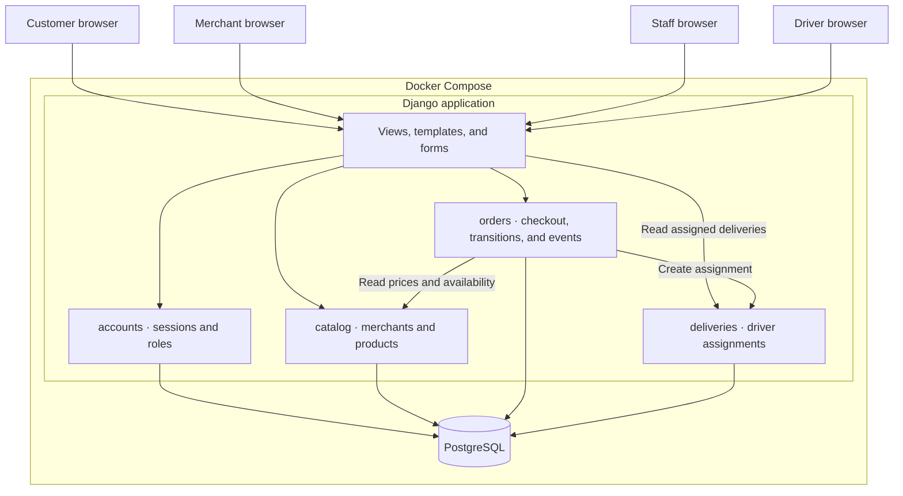
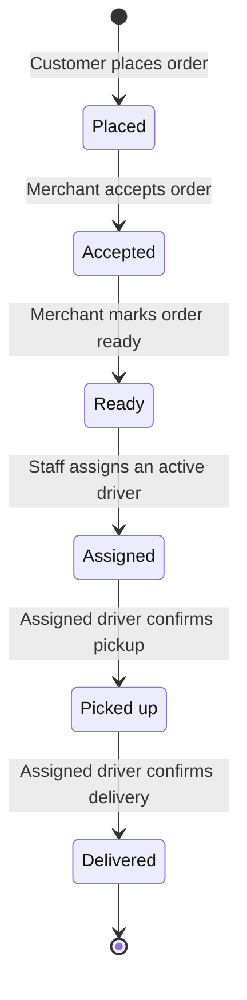
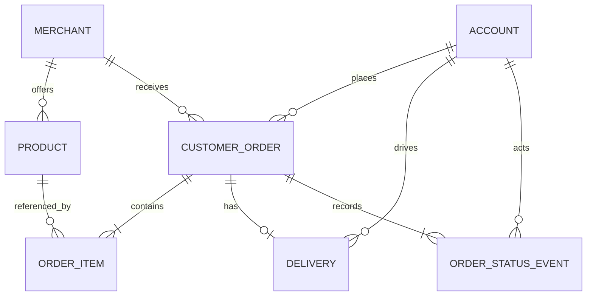
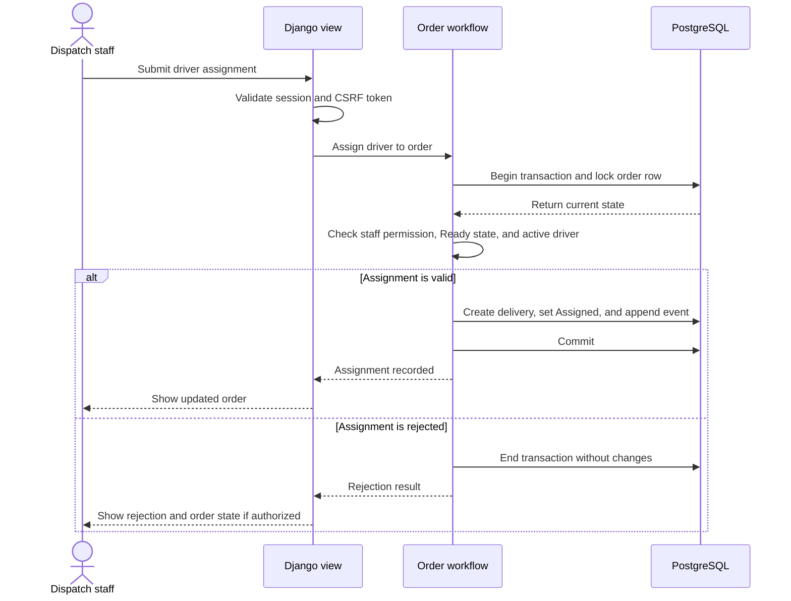

# Delivery prototype diagrams

These diagrams cover the proposed P0–P2 architecture, from the first catalog page through manual delivery. [Implementation plan](plan.md) · [Specification](specs.md)

## System architecture

Customers browse and place orders, merchants prepare them, dispatch staff assign drivers, and drivers confirm pickup and delivery. Each role uses the same Django application with its own permissions.

`orders` owns all lifecycle transitions, including staff assignment and driver confirmations. Django Admin manages demo accounts and catalog records and provides read-only access to order, delivery, and event records.

## Order lifecycle

Each arrow identifies the actor and action. P1 ends at **Ready**. P2 takes the order through **Delivered**. Each successful action records one status event.

The customer sees the current state and ordered event history when they refresh the order page. **Delivered** is terminal.

## Core data relationships

Each order belongs to one merchant. The order keeps the delivery address and total at checkout, and its items keep the product names and unit prices at checkout. The order has a unique customer and submission key pair for safe checkout retries. A delivery record is created on assignment, and status events store the actor, the state change, and the time.

## Driver assignment transaction

Assignment shows how the workflow keeps the order state, delivery, and event consistent. If staff submit competing assignments, the second request to acquire the order lock sees the committed **Assigned** state and is rejected.

