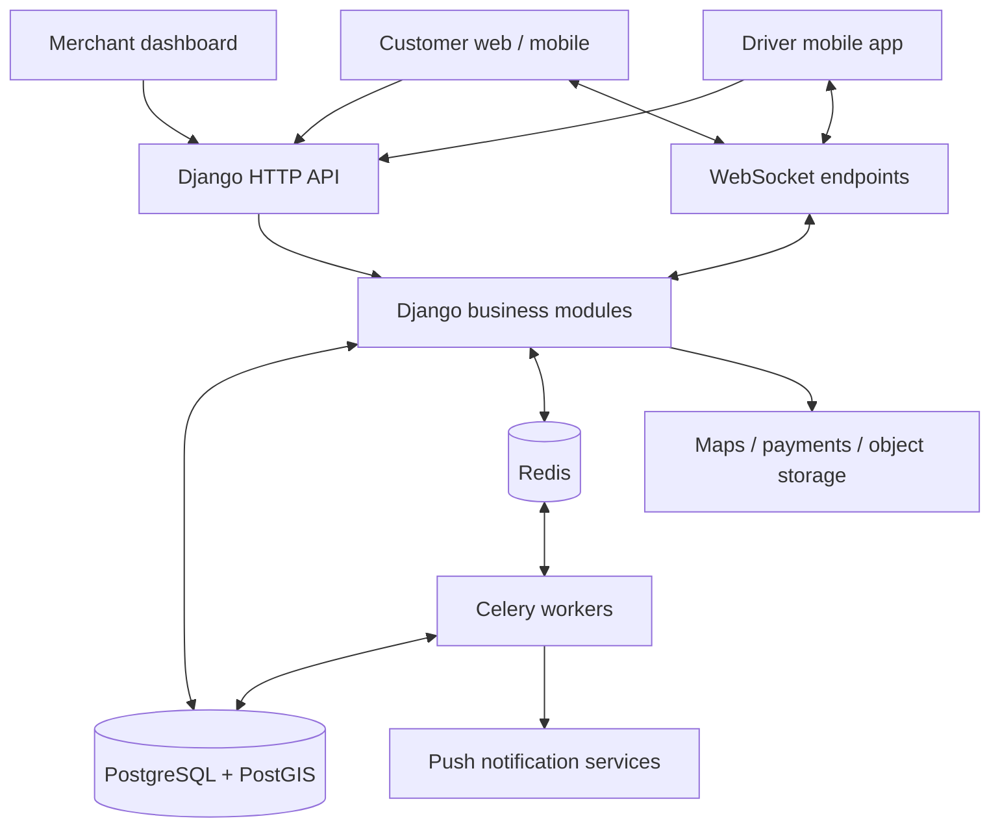
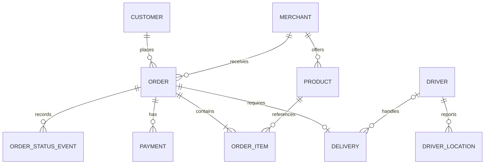

# Designing a DoorDash-like Application

*Technical overview and recommended implementation stack*

## 1. Overview

A DoorDash-like application is an on-demand delivery platform connecting customers, merchants and delivery drivers. It combines e-commerce, logistics, geospatial computing, real-time communication and transaction management.

### Main user roles

| Role | Responsibilities |
|---|---|
| Customer | Browse catalogs, place orders, pay, track deliveries and submit reviews. |
| Merchant | Manage products, prices, availability, orders and preparation times. |
| Driver | Accept delivery requests, navigate, confirm pickups and deliveries, and track earnings. |
| Administrator | Manage accounts, commissions, disputes, refunds and operational performance. |

### Typical order lifecycle

1. Customer selects products, delivery address and payment method.
2. Merchant accepts and prepares the order.
3. Platform assigns an available driver.
4. Driver picks up the order and travels to the customer.
5. Delivery is confirmed and payment settlement is processed according to platform policy.
6. Customer may provide a rating or review.

### Core requirements

- **Catalog and ordering:** product search, availability, shopping carts and order management.
- **Geolocation:** delivery zones, proximity searches, GPS tracking and routing.
- **Real-time communication:** order updates, driver location and push notifications.
- **Dispatch:** driver matching based on availability, location and estimated travel time.
- **Payments:** electronic payments, tips, fees, refunds and merchant payouts.
- **Security:** authentication, role-based authorization and protection of personal data.
- **Analytics:** sales, delivery performance, customer behavior and operational metrics.

Revenue may come from merchant commissions, delivery and service fees, subscriptions and sponsored listings.

## 2. Recommended technology stack

A Python-based backend with PostgreSQL and cross-platform mobile development provides a practical balance between development effort, maintainability and extensibility.

| Component | Recommended technology | Purpose |
|---|---|---|
| Backend | Python, Django | Business logic, ORM, authentication and administration |
| API | Django REST Framework | REST endpoints for web and mobile clients |
| Database | PostgreSQL | Relational and transactional data |
| Spatial database | PostGIS, GeoDjango | Spatial indexes, proximity searches and delivery zones |
| Initial web UI | Django Templates, HTMX, Bootstrap | Responsive interfaces with minimal JavaScript |
| Advanced web UI | React, Next.js | Optional richer customer and merchant interfaces |
| Mobile UI | React Native, Expo | Cross-platform driver and customer apps |
| Administration | Django Admin | Internal platform management |
| Real-time updates | Django Channels, WebSockets | Live order and location updates |
| Cache / broker | Redis | Caching, channel layer and task messaging |
| Background tasks | Celery | Notifications, dispatch and asynchronous processing |
| Maps | Leaflet; Google Maps or Mapbox services | Map display, geocoding and routing |
| Payments | Stripe Connect | Marketplace payments and payouts, subject to eligibility |
| Push notifications | Expo Notifications / FCM | Mobile alerts |
| Object storage | S3-compatible storage | Product images and delivery evidence |
| Deployment | Docker, Docker Compose, GitHub Actions | Packaging, deployment and CI/CD |
| Testing | pytest, pytest-django, Playwright | Backend, integration and browser testing |

## 3. Proposed architecture

Start with a **modular monolith**: one Django application organized into cohesive modules, with a shared relational database. Introduce separate services only when measurable operational needs justify them.

Suggested Django modules: `accounts`, `catalog`, `orders`, `dispatch`, `deliveries`, `payments`, `notifications`, and `analytics`.

### Interface strategy

| User | Initial interface | Future option |
|---|---|---|
| Customer | Responsive web application | Dedicated mobile application |
| Merchant | Web dashboard | Mobile merchant app if needed |
| Driver | React Native app | Enhanced native integrations |
| Administrator | Django Admin | Custom operational dashboard |

A driver app benefits particularly from native location permissions, background location tracking and push notifications. Test background behavior on both Android and iOS.

## 4. Data model and geospatial computing

Fundamental entities include `User`, `Customer`, `Merchant`, `Driver`, `Product`, `Order`, `OrderItem`, `Delivery`, `Payment`, `Address`, and `Review`. Additional useful entities include `DriverLocation`, `DeliveryZone`, and `OrderStatusEvent`.

This illustrative model assumes one merchant per order; a cart spanning multiple merchants would need additional modeling.

PostGIS enables spatial queries such as identifying nearby merchants and drivers, checking whether an address lies within a delivery zone, and analyzing historical delivery patterns. Spatial proximity is not the same as road distance: use a routing service for driving routes and travel-time estimates.

## 5. Implementation roadmap

| Phase | Scope | Key technologies |
|---|---|---|
| 1. MVP | Registration, catalogs, ordering, manual dispatch and basic status tracking | Django, PostgreSQL, PostGIS, HTMX, Bootstrap, Leaflet |
| 2. Operational platform | Driver app, live tracking, automatic dispatch, payments and notifications | DRF, React Native, Redis, Celery, Channels, Stripe Connect |
| 3. Intelligent platform | Forecasting, recommendations, delivery-time prediction and optimized dispatch | scikit-learn, LightGBM, OR-Tools, PyTorch |
| 4. Scaling | Horizontal scaling, database replicas, dedicated services and monitoring | Load balancers, managed databases, distributed messaging when justified |

An MVP can use simulated payments and manually assigned drivers for demonstration. Before accepting real orders, implement payment verification, reliable order-state transitions, refunds, privacy protections and operational support.

## 6. Data science and AI opportunities

| Operational problem | Potential technique |
|---|---|
| Delivery-time prediction | Regression, gradient boosting |
| Demand forecasting | Time-series forecasting |
| Driver assignment | Bipartite matching, combinatorial optimization |
| Multi-order delivery | Vehicle routing problem (VRP) |
| Product recommendations | Collaborative and content-based filtering |
| Dynamic delivery fees | Predictive modeling and constrained optimization |
| Fraud detection | Classification, anomaly detection |
| Driver repositioning | Optimization, reinforcement learning |
| Customer segmentation | Clustering |

Collect reliable event timestamps and operational data from the beginning. Establish simple baselines before introducing more sophisticated models.

## 7. Deployment and operational considerations

An initial deployment could use a virtual server (e.g., DigitalOcean, Hetzner or AWS Lightsail), managed PostgreSQL with backups, Docker Compose, Caddy or Nginx for HTTPS, Cloudflare for DNS and GitHub Actions for CI/CD. Kubernetes, Kafka and microservices are not prerequisites for an initial deployment.

Key engineering challenges include concurrent order updates, duplicate payment or dispatch requests, inaccurate GPS readings, intermittent mobile connectivity, delivery-time uncertainty and secure handling of customer addresses. Use database transactions, idempotency keys, payment webhooks, role-based access and monitoring. Verify regional availability and merchant onboarding requirements for payment and mapping services before commercial deployment, particularly for Puerto Rico.

## 8. Recommended starting configuration

**Python + Django + PostgreSQL/PostGIS + HTMX + Bootstrap + Leaflet + Docker**, adding React Native for drivers and Redis/Celery/Channels as real-time and asynchronous requirements emerge.

Design for scalability, but implement for simplicity. Prioritize a reliable end-to-end order lifecycle before adding advanced logistics algorithms or distributed infrastructure.

## Further reading

- [Django](https://docs.djangoproject.com/)
- [Django REST Framework](https://www.django-rest-framework.org/)
- [GeoDjango](https://docs.djangoproject.com/en/stable/ref/contrib/gis/)
- [PostGIS](https://postgis.net/)
- [Django Channels](https://channels.readthedocs.io/)
- [Celery](https://docs.celeryq.dev/)
- [HTMX](https://htmx.org/docs/)
- [React Native](https://reactnative.dev/)
- [Expo](https://docs.expo.dev/)
- [Stripe Connect](https://docs.stripe.com/connect)
- [Google OR-Tools](https://developers.google.com/optimization)

